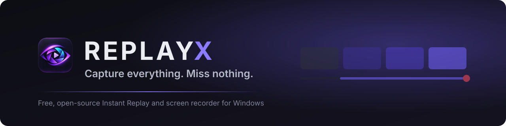

<p align="center">
  
</p>

<p align="center">
  <b>A free, open-source game recorder for Windows.</b><br>
  REPLAYX quietly keeps the last moments of your game, so when something great happens,<br>
  one shortcut saves it as a clip. No account, no ads, nothing uploaded.
</p>

<p align="center">
  <a href="https://github.com/PrithviGhale/REPLAYX/releases/download/v0.3.1-alpha.6/REPLAYX_0.3.1-alpha.6_x64-setup.exe"></a>
  <br>
  <sub><a href="https://github.com/PrithviGhale/REPLAYX/releases/tag/v0.3.1-alpha.6">Release notes and checksums</a> · <a href="https://github.com/PrithviGhale/REPLAYX/releases">All releases</a></sub>
</p>

<p align="center">
  <a href="https://github.com/PrithviGhale/REPLAYX/releases"></a>
  
  <a href="https://github.com/PrithviGhale/REPLAYX/actions/workflows/check.yml"></a>
  <a href="LICENSE"></a>
</p>

<p align="center">
  
</p>

## Features

- **Instant Replay.** Keeps the last 30 seconds to 30 minutes on disk. Press <kbd>Ctrl</kbd>+<kbd>Shift</kbd>+<kbd>F10</kbd> and the moment is a clip, usually within a second.
- **Hardware recording.** NVIDIA, Intel and AMD encoders, H.264, HEVC or AV1, 720p–4K output. Synthetic workload measurements are in [Performance](docs/development/PERFORMANCE.md); real-game overhead remains under investigation.
- **Clips sorted by game.** 140 games recognised automatically, each with its own icon, in a library you can search, sort and export to MP4.
- **Clean voice, separate tracks.** The Voice Enhancer removes background noise; game, chat and microphone each get their own track.
- **Playtime tracking.** See how long you play each game, by day, week or month, with charts.
- **Private by design.** Everything stays on your PC: no account, no telemetry, no uploads.

[See every feature →](docs/guide/FEATURES.md)

## Install

1. Download **`REPLAYX_0.3.1-alpha.6_x64-setup.exe`** with the button above.
2. Run it. It installs for your account only, without administrator rights.
3. Builds aren't code-signed yet: if SmartScreen appears, choose **More info → Run anyway**, ideally after checking the file against the release's `SHA256SUMS.txt`.

Requires Windows 10 or 11 (64-bit); a GPU with hardware encoding is recommended. [Full setup guide →](docs/guide/GETTING_STARTED.md)

## How Instant Replay works

While Instant Replay is on, REPLAYX records continuously into a small rolling buffer on disk (short segments, oldest dropped first). When you press **Save replay**, it joins the last 30 seconds to 30 minutes into one clip without re-encoding, checks that it plays, and files it under the game you were playing. Normal recordings run alongside and are saved the same way.

## Capture and encoders

| | |
| --- | --- |
| **Capture** | Desktop Duplication (default) or Windows Graphics Capture (experimental, *Video → Capture method*); full display or a region |
| **Encoders** | NVIDIA NVENC, Intel Quick Sync, AMD AMF, with a software fallback; *Auto* picks the most efficient one that works on your PC |
| **Codecs** | H.264, HEVC, AV1 (where the GPU supports them) |
| **Output** | 720p to 4K, 30 to 144 FPS; Native, Fit, Crop and Stretch (4:3 stretched games) |
| **Audio** | Up to six sources: system sound, individual apps, microphone (with Voice Enhancer); one track each plus a full mix |

## System requirements

- Windows 10 or 11, 64-bit (Windows Graphics Capture needs Windows 10 1903 or later)
- A GPU with hardware video encoding (NVIDIA, Intel or AMD) is strongly recommended; REPLAYX falls back to software encoding without one
- About 2 GB of free disk space for the replay buffer (adjustable)

## Shortcuts

| Save replay | Record | Replay on / off | Mute mic | Open / hide |
| :---: | :---: | :---: | :---: | :---: |
| <kbd>Ctrl</kbd>+<kbd>Shift</kbd>+<kbd>F10</kbd> | <kbd>Ctrl</kbd>+<kbd>Shift</kbd>+<kbd>F9</kbd> | <kbd>Ctrl</kbd>+<kbd>Shift</kbd>+<kbd>F8</kbd> | <kbd>Ctrl</kbd>+<kbd>Shift</kbd>+<kbd>M</kbd> | <kbd>Ctrl</kbd>+<kbd>Shift</kbd>+<kbd>F11</kbd> |

All of them work in games and can be changed in **Settings → Hotkeys**.

## Building from source

```powershell
git clone https://github.com/PrithviGhale/REPLAYX.git
cd REPLAYX
npm ci
powershell -ExecutionPolicy Bypass -File scripts/prepare-bundle.ps1   # pinned, checksum-verified FFmpeg runtime
npx tauri dev                              # or: npx tauri build
```

Requires Node 24, the Rust MSVC toolchain, the Visual Studio C++ build tools with a Windows SDK, and WebView2. `scripts/check.ps1` runs everything CI runs. Details: [Building](docs/development/BUILDING.md).

## Known limitations

- On laptops whose screen is driven by the integrated GPU, recording can noticeably lower the FPS of CPU-heavy games (about 19% measured in Fortnite with Windows Graphics Capture and Quick Sync). Screens driven by the dedicated GPU are much less affected. Investigation: [docs/engineering](docs/README.md#engineering-reports).
- Exclusive full-screen games can hide REPLAYX's on-screen notices (recording itself is not affected).
- Builds are not code-signed yet.

More: [Known limitations](docs/guide/KNOWN_LIMITATIONS.md).

## Learn more

[Documentation](docs/README.md) · [FAQ](docs/guide/FAQ.md) · [Troubleshooting](docs/guide/TROUBLESHOOTING.md) · [Build from source](docs/development/BUILDING.md) · [Report a bug](https://github.com/PrithviGhale/REPLAYX/issues/new/choose) · [Contributing](.github/CONTRIBUTING.md)

---

> [!NOTE]
> **REPLAYX is in alpha.** It works well on the PCs it has been tested on, but it hasn't been used on many yet. See the [known limitations](docs/guide/KNOWN_LIMITATIONS.md), and please report anything that goes wrong.

REPLAYX is [MIT-licensed](LICENSE). It ships an LGPL build of FFmpeg, whose source is published with every release, and other open-source components listed in the [third-party notices](THIRD_PARTY_NOTICES.md).
