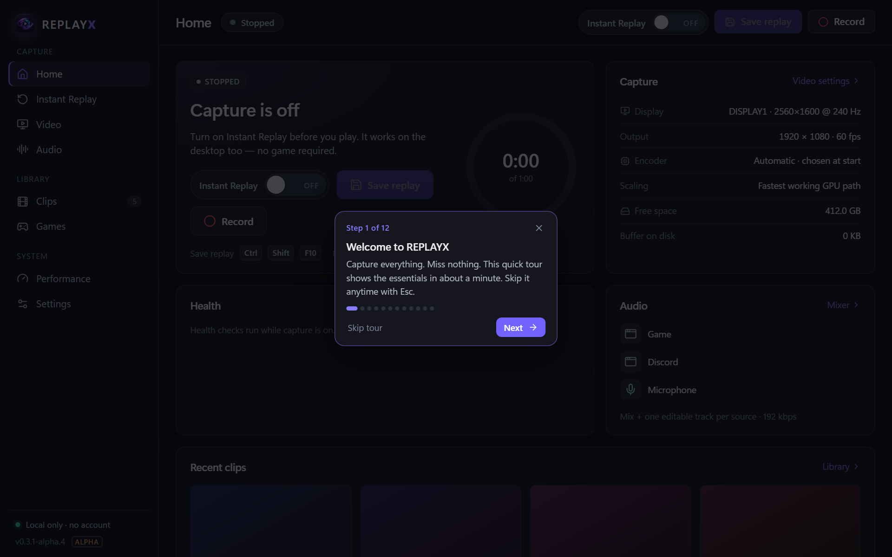
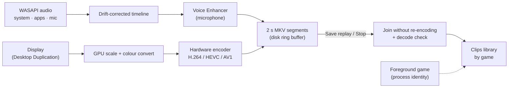

<p align="center">
  
</p>

<p align="center">
  
  
  
</p>

<p align="center">
  <b>REPLAYX</b> is a free, open-source Instant Replay and screen recorder for Windows gamers.<br>
  It keeps the last moments of your game on disk, so the play you didn't expect is one shortcut away,<br>
  with clean microphone audio, separate tracks and clips sorted by game. No account, no ads, no telemetry.
</p>

<p align="center">
  <a href="#download">Download</a> ·
  <a href="#getting-started">Getting started</a> ·
  <a href="#features">Features</a> ·
  <a href="docs/KNOWN_LIMITATIONS.md">Known limitations</a> ·
  <a href="docs/ARCHITECTURE.md">How it works</a>
</p>

<p align="center">
  
</p>
<p align="center"><sub>Screenshots show the real REPLAYX interface with sample data.</sub></p>

> [!IMPORTANT]
> **REPLAYX is alpha software.** Capture, saving and the clip library are tested on real hardware (see [VALIDATION](docs/VALIDATION.md)), but it has been used on few machines so far, and builds are not code-signed yet, so Windows SmartScreen may warn. Read [Known limitations](docs/KNOWN_LIMITATIONS.md) before relying on it for something you can't replay.

## Download

The first public release is being prepared. When it is published, the Windows installer (`REPLAYX_<version>_x64-setup.exe`) and its SHA-256 checksum will be on this repository's **Releases** page. Until then you can [build REPLAYX from source](#build-from-source).

## Features

### Instant Replay
Turn it on before you play. REPLAYX keeps a rolling window of the last 30 seconds to 30 minutes **on disk** (not in memory), bounded by a disk budget you choose. Press <kbd>Ctrl</kbd>+<kbd>Shift</kbd>+<kbd>F10</kbd> and the last moments are saved as a clip; buffering carries on, and overlapping saves are fine. Clips are joined from finished 2-second segments without re-encoding, so a 60-second replay is usually ready about a second after you press save.

### Recording
<kbd>Ctrl</kbd>+<kbd>Shift</kbd>+<kbd>F9</kbd> starts and stops a normal recording. If Instant Replay is running, the recording joins it instantly, without restarting capture or leaving a gap.

### Quality and codecs
- **Exact output size:** 720p, 1080p, 1440p, 4K, your display's shape or custom. 1920 × 1080 always saves a 1920 × 1080 file; stretched 4:3 gameplay can be recorded full-frame.
- **Presets:** Performance, Balanced, High quality or a custom bitrate. On NVIDIA GPUs the presets use constant quality with a size cap (measured: same picture as before for about 12% less space).
- **Codecs:** H.264 (default, plays everywhere), HEVC and AV1 (about 25% smaller than H.264 at the same measured quality). Only codecs your PC can encode are offered, and REPLAYX never switches codec by itself.
- **Hardware encoding:** NVIDIA NVENC, Intel Quick Sync (including its low-power encoder) and AMD AMF, chosen by real probes, with a CPU fallback. A storage estimate shows MB per minute, GB per hour and the recording time left on your drive.

<p align="center">
  
  
</p>

### Microphone and Voice Enhancer
Your microphone is part of every setup and is recorded on **its own track**. The **Voice Enhancer** cleans it up with REPLAYX's own real-time processing:

| Preset | What it does |
| --- | --- |
| **Off** | Your microphone exactly as Windows delivers it. |
| **Natural** | Removes rumble and a little background noise; sounds like your mic, only cleaner. |
| **Clear** (default) | Removes background noise, makes words easier to understand, evens out levels gently. |
| **Broadcast** | A fuller, steadier "streamer" voice: warmth, presence, stronger compression, softer S sounds. |
| **Noise-Free** | The strongest background-noise removal, quiet between words. |

Noise suppression (Off, Light, Balanced, Strong) uses **RNNoise**. In our tests on speech mixed with fan noise it removed about 10, 17 and 25 dB of the noise while leaving the speech practically unchanged, using about 1% of one CPU core. **Test mic** lets you hear yourself live, exactly as you will be recorded, and switch between *Enhanced* and *Original* at the same loudness. **Compare** records one short take (kept in memory only) so you can hear both versions of the same words. Fine-tune gives you recording gain, a rumble filter, a soft gate, compressor, EQ and de-esser, and you can save your own presets. REPLAYX never changes your Windows microphone level.

<p align="center">
  
</p>

### Separate audio tracks
System sound, individual apps (game, Discord, music) and your microphone each get their own track, plus a full mix on track 1 so every player plays everything. New microphones and headsets are picked up automatically when you plug them in.

### Game detection and clip folders
REPLAYX recognises 140 games (Fortnite, Roblox, Valorant, Minecraft, Counter-Strike 2, Apex, Call of Duty, Overwatch 2, League of Legends, Genshin Impact and many more, plus games in Steam, Epic, Xbox and other store folders) by process identity only. It never injects into or reads from games. Clips are saved as `Videos\REPLAYX\<Game>\<Game>_2026-11-07_21-30-12.mkv`. Browse *All clips* or *By game* tiles, sort and filter by game, type and date, search, rename, change the game, export to MP4 or delete to the Recycle Bin. Each game shows its own icon.

### Games and playtime
A local playtime tracker, on from the start: the **Games** page shows how long you played each game today, yesterday, this week, this month or any dates you choose, with a daily chart, your most-played games and a page per game with its sessions and clips. It counts only time while the game is the window in front and REPLAYX is running, skips idle stretches and sleep, and stays on your PC. Turn it off, pause it, exclude games, export or clear it whenever you like.

### Status overlay
Small icons in a corner of your screen show Instant Replay, your microphone and a red dot while recording, over games, apps and the desktop. You see them while you play; Windows keeps them **out of your recordings** (verified on captured frames). Corner, opacity and icons are configurable. A short pop-up also slides in when a recording starts and when an Instant Replay or recording is saved (it can be turned off).

<p align="center">
  
  
</p>

### Runs quietly in the background
REPLAYX can live in the system tray: Instant Replay, recording and shortcuts keep working while the window is closed. The tray menu shows the real state and asks before quitting during a recording or save. A short guided tour introduces everything on first launch and can be replayed from Settings.

## Requirements

- Windows 10 or 11, 64-bit. Per-app audio tracks need Windows 10 build 20348 or later (or Windows 11); the overlay's exclusion from recordings needs Windows 10 version 2004 or later.
- A GPU with hardware video encoding (NVIDIA GTX 900 series or newer, Intel HD 500 series or newer, AMD RX 400 series or newer) is recommended; otherwise REPLAYX encodes on the CPU. AV1 needs an NVIDIA RTX 40, Intel Arc/Core Ultra or AMD RX 7000 GPU. Development and testing use an Intel Iris Xe + NVIDIA RTX 4070 Laptop.
- Microsoft Edge WebView2 Runtime: included with Windows 11; on Windows 10 the installer downloads it if missing.
- Free disk space for the replay buffer (the default 2 GB budget holds about 15 minutes at 1080p60 Balanced with typical audio).

## Getting started

1. Install with `REPLAYX_<version>_x64-setup.exe`. Because builds are not code-signed yet, SmartScreen may say *Windows protected your PC*; choose **More info → Run anyway** only if the file's SHA-256 matches the published checksum (`Get-FileHash .\REPLAYX_*_x64-setup.exe`).
2. Open REPLAYX and follow the one-minute tour (or skip it with <kbd>Esc</kbd>).
3. In **Audio**, choose your microphone and a Voice Enhancer preset; click **Test mic** to hear yourself.
4. Turn **Instant Replay** on (top right) and play. When something happens, press <kbd>Ctrl</kbd>+<kbd>Shift</kbd>+<kbd>F10</kbd>.
5. Open **Clips** to watch, rename, export or delete. Uninstalling never deletes your clips in `Videos\REPLAYX`.

### Keyboard shortcuts

| Action | Default |
| --- | --- |
| Save replay | <kbd>Ctrl</kbd>+<kbd>Shift</kbd>+<kbd>F10</kbd> (Alt+F10 if no other app uses it) |
| Start / stop recording | <kbd>Ctrl</kbd>+<kbd>Shift</kbd>+<kbd>F9</kbd> |
| Instant Replay on / off | <kbd>Ctrl</kbd>+<kbd>Shift</kbd>+<kbd>F8</kbd> |
| Mute microphone | <kbd>Ctrl</kbd>+<kbd>Shift</kbd>+<kbd>M</kbd> |

All shortcuts work in games and can be changed in **Settings → Hotkeys**.

### Settings at a glance

| Page | What you set there |
| --- | --- |
| **Instant Replay** | Replay length, disk budget, recovery of interrupted sessions |
| **Video** | Display, resolution, fill mode, frame rate, encoder, codec, quality, storage estimate |
| **Audio** | Microphone and Voice Enhancer, sound sources, tracks and audio quality |
| **Settings** | Clips folder, game detection, status overlay, tray behaviour, start with Windows, shortcuts, tutorial |

## Troubleshooting

| Problem | What to try |
| --- | --- |
| My microphone is silent | Check **Windows Settings → Privacy & security → Microphone**, pick the right device in **Audio**, and use **Test mic**. If you use Voicemod or another virtual mic, choose your real headset instead, or REPLAYX processes already-processed audio. |
| My voice sounds too processed | Choose **Natural** or lower noise suppression to **Light**; compare with **Test mic → Original**. |
| Games lose FPS while recording | Use 60 fps and the **Performance** or **Balanced** preset; the **Performance** page shows if the encoder falls behind. |
| The overlay doesn't show in a game | Windows can't show desktop windows over exclusive full-screen games. Use borderless or windowed mode. |
| SmartScreen blocks the installer | Builds aren't code-signed yet. Compare the SHA-256 with the published checksum before choosing *Run anyway*. |
| Something else | See [Known limitations](docs/KNOWN_LIMITATIONS.md) or open an issue with your Windows version, GPU and what you did. |

## How it works



Capture and encoding run in a separate FFmpeg process managed by the Rust engine; audio capture and voice processing run in the engine's own threads and never block video. The interface is a Tauri 2 window that never waits on the engine. Details: [ARCHITECTURE](docs/ARCHITECTURE.md), measurements: [PERFORMANCE](docs/PERFORMANCE.md), evidence for each claim: [VALIDATION](docs/VALIDATION.md), audio research: [RESEARCH](docs/RESEARCH.md).

**Technology:** Rust · Tauri 2 · React 19 + TypeScript · FFmpeg (LGPL build, pinned and checksum-verified) · WASAPI · DXGI Desktop Duplication · RNNoise (nnnoiseless) · Win32.

## Build from source

Windows 10/11 x64, Node 24, Rust 1.98 (MSVC) and WebView2. Full instructions are in [BUILDING](docs/BUILDING.md).

```powershell
git clone https://github.com/PrithviGhale/REPLAYX.git
cd REPLAYX
npm ci
powershell -ExecutionPolicy Bypass -File scripts/setup-media.ps1   # pinned, checksum-verified FFmpeg (LGPL)
powershell -ExecutionPolicy Bypass -File scripts/check.ps1         # format, tests, Clippy, frontend build
npm run desktop                                                    # run in development
npm run tauri build                                                # NSIS installer in src-tauri/target/release/bundle
```

### Project layout

```
src/                 React interface (pages, splash, tour, components, status store)
src-tauri/src/       Rust engine: capture pipeline, audio, Voice Enhancer, encoding, library, overlay, game detection
src-tauri/src/bin/   replayx-cli (engine and evaluation tools) and replayx-gameproxy (benchmark workload)
scripts/             Build, release and measurement scripts
tests/               Frontend unit tests
dev/                 UI preview with mock data and headless UI checks
docs/                Architecture, building, performance, validation, research, roadmap, releasing
```

## Roadmap

Highlights: code-signed builds, per-game profiles, a clip trimmer, more GPUs measured, and comparisons of the Voice Enhancer against real headset recordings. The full list is in [ROADMAP](docs/ROADMAP.md).

## Contributing

Bug reports, measurements from your hardware and pull requests are welcome. Start with [CONTRIBUTING](CONTRIBUTING.md) and the [Code of Conduct](CODE_OF_CONDUCT.md). Report security issues privately ([SECURITY](SECURITY.md)).

## Privacy

REPLAYX has no account, telemetry, analytics or uploads. Recordings, settings and microphone tests stay on your PC; the microphone is only opened while you record with it or test it. See [PRIVACY](PRIVACY.md).

## Licence

REPLAYX is released under the [MIT licence](LICENSE). It uses FFmpeg under the LGPL (shipped as separate, replaceable libraries), RNNoise via nnnoiseless (BSD-3-Clause) and other open-source components listed in [THIRD_PARTY_NOTICES](THIRD_PARTY_NOTICES.md). H.264, HEVC and AAC may be subject to patents in some countries; the software licence does not grant patent rights.
