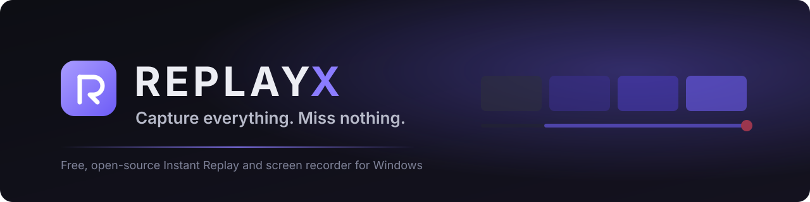
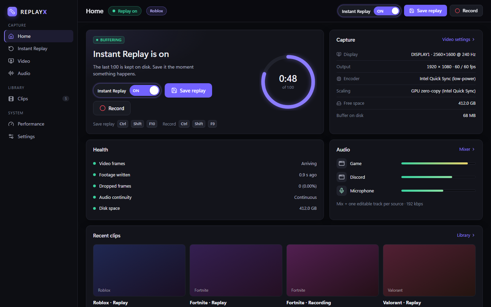
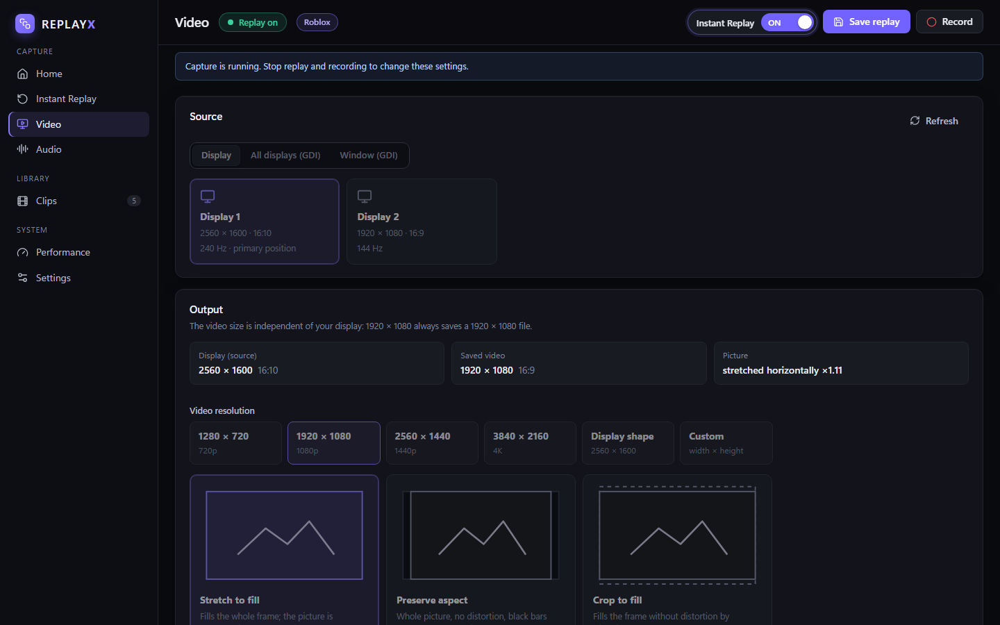
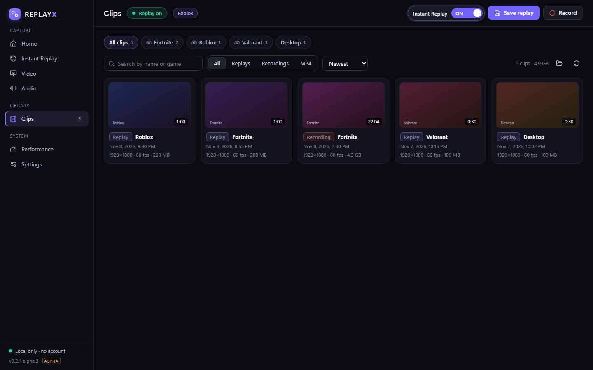
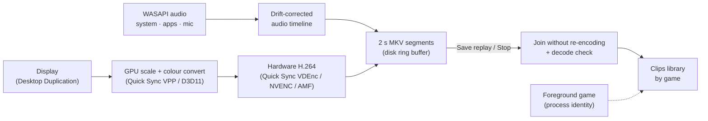

<p align="center">
  
</p>

<p align="center">
  <a href="https://github.com/PrithviGhale/REPLAYX/releases"></a>
  
  <a href="LICENSE"></a>
  <a href="https://github.com/PrithviGhale/REPLAYX/actions/workflows/check.yml"></a>
</p>

<p align="center">
  <b>REPLAYX</b> is a free, open-source Instant Replay and screen recorder for Windows.<br>
  It keeps the last moments of your game or desktop on disk, so the play you didn't expect is one hotkey away.
</p>

<p align="center">
  <a href="https://github.com/PrithviGhale/REPLAYX/releases"><b>⬇ Download for Windows</b></a> ·
  <a href="#quick-start">Quick start</a> ·
  <a href="docs/KNOWN_LIMITATIONS.md">Known limitations</a> ·
  <a href="docs/ARCHITECTURE.md">How it works</a>
</p>

<p align="center">
  
</p>

> [!IMPORTANT]
> **REPLAYX is alpha software.** Capture, saving and the clip library are tested on real hardware (see [VALIDATION](docs/VALIDATION.md)). Game-FPS impact is still being measured on more machines, and builds are not code-signed yet, so Windows SmartScreen may warn. Read [Known limitations](docs/KNOWN_LIMITATIONS.md) before relying on it for something you can't replay.

## Why REPLAYX

- **No account, no ads, no telemetry.** It runs entirely on your PC and sends nothing anywhere.
- **Honest by design.** The app shows what it measured: encoder speed, dropped frames, audio continuity, the exact GPU path in use. A clip only counts as saved after it has been decoded and checked.
- **Built for gaming PCs and laptops.** It prefers the GPU's fixed-function encoders and avoids frame copies through the CPU, including on laptops where the display runs on the integrated GPU.

## Features

| | |
| --- | --- |
| **Instant Replay** | Rolling buffer of the last 30 seconds to 30 minutes on disk. Save with <kbd>Ctrl</kbd>+<kbd>Shift</kbd>+<kbd>F10</kbd>; buffering continues, and overlapping saves are fine. A clear on/off switch shows the real buffer state. |
| **Recording** | Start and stop with <kbd>Ctrl</kbd>+<kbd>Shift</kbd>+<kbd>F9</kbd>. Recording joins a running replay buffer instantly, without restarting capture. |
| **Fast saves** | Clips are joined from finished 2-second segments without re-encoding. In our tests a 60-second replay was playable about a second after saving. |
| **Hardware encoding** | Intel Quick Sync (including the low-power fixed-function encoder), NVIDIA NVENC and AMD AMF, chosen automatically by real probes, with a CPU fallback. |
| **Exact output size** | 720p, 1080p, 1440p, 4K, your display's own shape, or custom. 1920 × 1080 always saves a 1920 × 1080 file. Stretch, preserve (bars) or crop, explained before you choose. |
| **Quality presets** | Performance, Balanced, High quality or a custom bitrate, scaled to your resolution and frame rate. |
| **60 and 120 fps** | Constant-frame-rate H.264 at 30, 60, 120 or 144 fps. The Performance page warns if the encoder can't keep up. |
| **Separate audio tracks** | System audio, individual apps (game, Discord, music) and microphone, each on its own track plus a mix for normal players. |
| **Game detection** | Recognises Fortnite, Roblox, Valorant, Minecraft, Counter-Strike 2 and games from Steam, Epic and Xbox folders by process identity only. It never injects into games. A small corner notice shows when a game is detected. |
| **Clips by game** | Saves to `Videos\REPLAYX\<Game>\<Game>_2026-11-07_21-30-12.mkv`. Browse by game, search, rename, change the game, export MP4 or delete to the Recycle Bin. |
| **Stretched 4:3** | Records 1440 × 1080 or 1280 × 960 gameplay as full-frame 1920 × 1080, the way it looks on your screen, and restarts safely when the game changes the display mode. |
| **Crash-safe** | MKV segments survive crashes. Interrupted sessions can be recovered, or discarded to the Recycle Bin. |

<p align="center">
  
  
</p>
<p align="center"><sub>Screenshots of the 0.2.1-alpha.3 interface with sample data.</sub></p>

## Requirements

- Windows 10 or Windows 11, 64-bit. Per-app audio tracks need Windows 10 build 20348 or later (or Windows 11).
- A GPU with hardware H.264 encoding (Intel Quick Sync, NVIDIA NVENC or AMD AMF) is recommended; otherwise REPLAYX encodes on the CPU. Development and testing use an Intel Iris Xe + NVIDIA RTX 4070 Laptop; other hardware reports are welcome.
- Microsoft Edge WebView2 Runtime: included with Windows 11; on Windows 10 the installer downloads it if it is missing.

## Install

1. Download `REPLAYX_<version>_x64-setup.exe` from the [latest release](https://github.com/PrithviGhale/REPLAYX/releases).
2. Optionally check its SHA-256 against `SHA256SUMS.txt` from the same release: `Get-FileHash .\REPLAYX_*_x64-setup.exe`.
3. Run it. Because builds are not code-signed yet, SmartScreen may show *Windows protected your PC*. Choose **More info → Run anyway** only if the checksum matches.

Uninstall from *Settings → Apps*. Your clips in `Videos\REPLAYX` are never deleted by the uninstaller.

## Quick start

1. Open **REPLAYX** and turn **Instant Replay** on (top right). The ring fills as history builds up.
2. Play. When something happens, press <kbd>Ctrl</kbd>+<kbd>Shift</kbd>+<kbd>F10</kbd> or click **Save replay**.
3. Open **Clips** to play, rename, export or delete. Clips are filed by game.

### Default shortcuts

| Action | Shortcut |
| --- | --- |
| Save replay | <kbd>Ctrl</kbd>+<kbd>Shift</kbd>+<kbd>F10</kbd> |
| Start / stop recording | <kbd>Ctrl</kbd>+<kbd>Shift</kbd>+<kbd>F9</kbd> |
| Instant Replay on / off | <kbd>Ctrl</kbd>+<kbd>Shift</kbd>+<kbd>F8</kbd> |
| Mute microphone | <kbd>Ctrl</kbd>+<kbd>Shift</kbd>+<kbd>M</kbd> |

All shortcuts can be changed in **Settings**.

### Tips

- **Best game performance:** keep 60 fps and the **Performance** or **Balanced** preset. 120 fps doubles capture and encoding work.
- **Stretched Valorant/CS2:** in **Video**, choose **1920 × 1080** and **Stretch to fill**.
- **Game, Discord and mic on separate tracks:** in **Audio**, turn off *System output* and add each app with **Application…**, plus your microphone.

## How it works



Capture, encoding and audio run in a separate FFmpeg process managed by the Rust engine. The interface is a Tauri 2 window that never waits on the engine. The details are in [ARCHITECTURE](docs/ARCHITECTURE.md), measurements in [PERFORMANCE](docs/PERFORMANCE.md), and the evidence for every claim in [VALIDATION](docs/VALIDATION.md).

**Tech stack:** Rust · Tauri 2 · React 19 + TypeScript · FFmpeg (LGPL build, pinned and checksum-verified) · WASAPI · DXGI Desktop Duplication · Win32.

## Build from source

Windows 10/11 x64, Node 24, Rust 1.98 (MSVC) and WebView2. Full instructions are in [BUILDING](docs/BUILDING.md).

```powershell
git clone https://github.com/PrithviGhale/REPLAYX.git
cd REPLAYX
npm ci
powershell -ExecutionPolicy Bypass -File scripts/setup-media.ps1   # pinned, checksum-verified FFmpeg (LGPL)
powershell -ExecutionPolicy Bypass -File scripts/check.ps1         # format, tests, Clippy, frontend build
npm run desktop                                                    # run in development
npm run tauri build                                                # NSIS installer in src-tauri/target/release/bundle
```

## Project layout

```
src/                 React interface (pages, components, status store)
src-tauri/src/       Rust engine: capture pipeline, audio, encoding, library, game detection
src-tauri/src/bin/   replayx-cli (engine without UI) and replayx-gameproxy (benchmark workload)
scripts/             Build, release and measurement scripts (see scripts/README.md)
tests/               Frontend unit tests
docs/                Architecture, building, performance, validation, roadmap, releasing
```

## Contributing

Bug reports, measurements from your hardware and pull requests are welcome. Start with [CONTRIBUTING](CONTRIBUTING.md) and the [Code of Conduct](CODE_OF_CONDUCT.md). Report security issues privately ([SECURITY](SECURITY.md)). The [roadmap](docs/ROADMAP.md) lists what's next.

## Privacy

REPLAYX has no account, telemetry, analytics or network uploads. Recordings and settings stay on your PC. See [PRIVACY](PRIVACY.md).

## Licence

REPLAYX is released under the [MIT licence](LICENSE). It uses FFmpeg under the LGPL 2.1+ (shipped as separate, replaceable libraries) and other open-source components listed in [THIRD_PARTY_NOTICES](THIRD_PARTY_NOTICES.md). H.264 and AAC may be subject to patents in some countries; the software licence does not grant patent rights.
