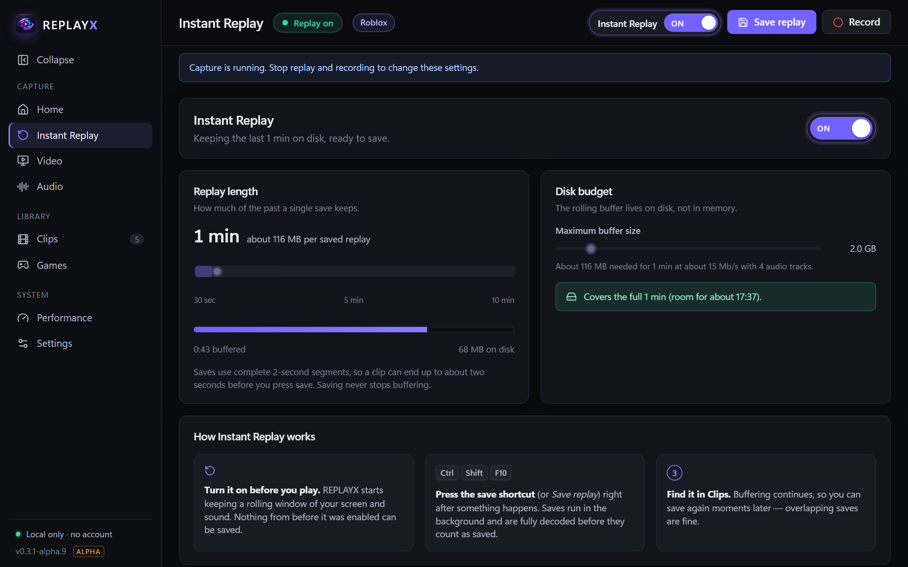
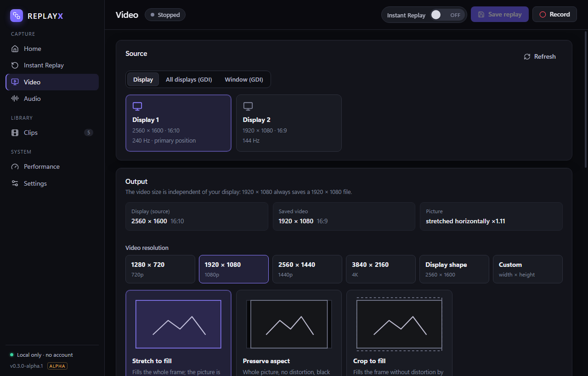
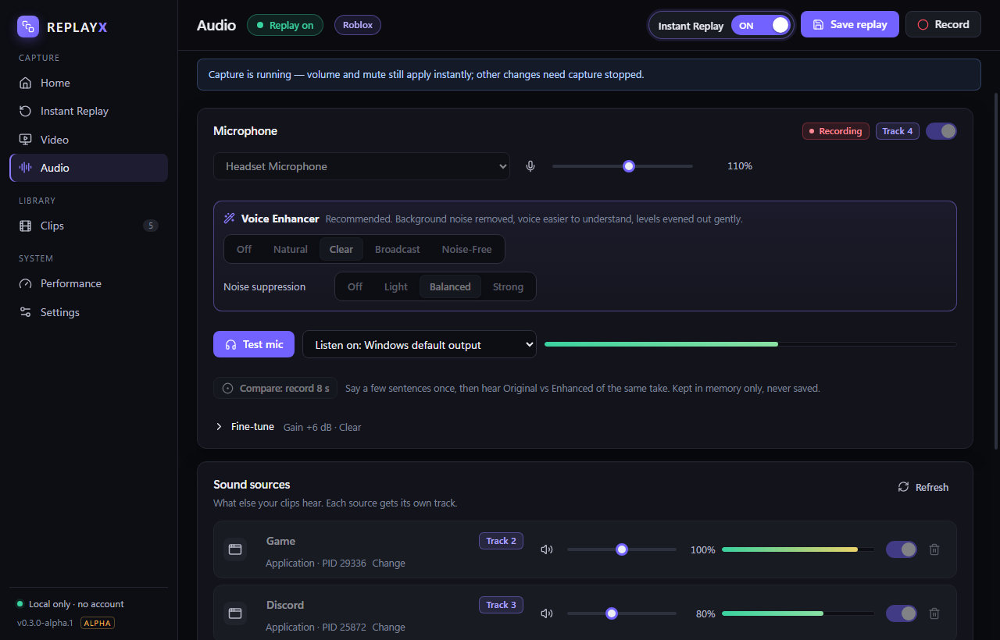
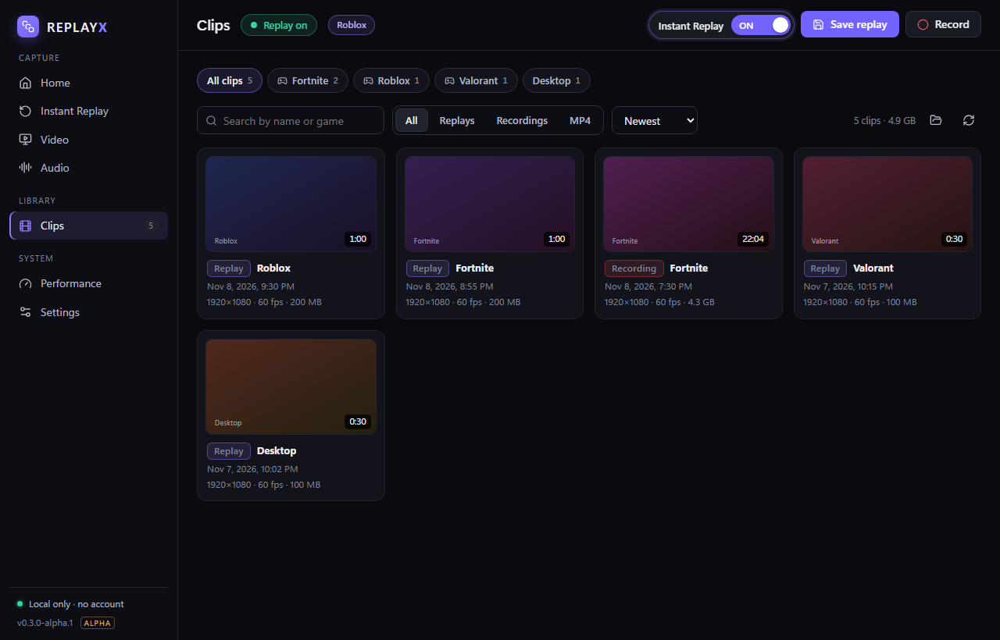
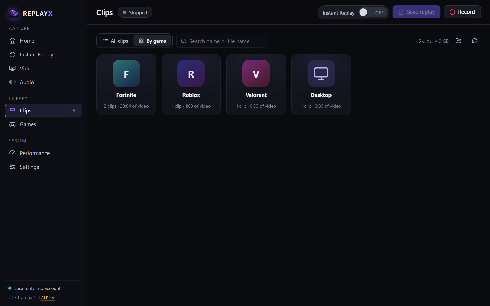
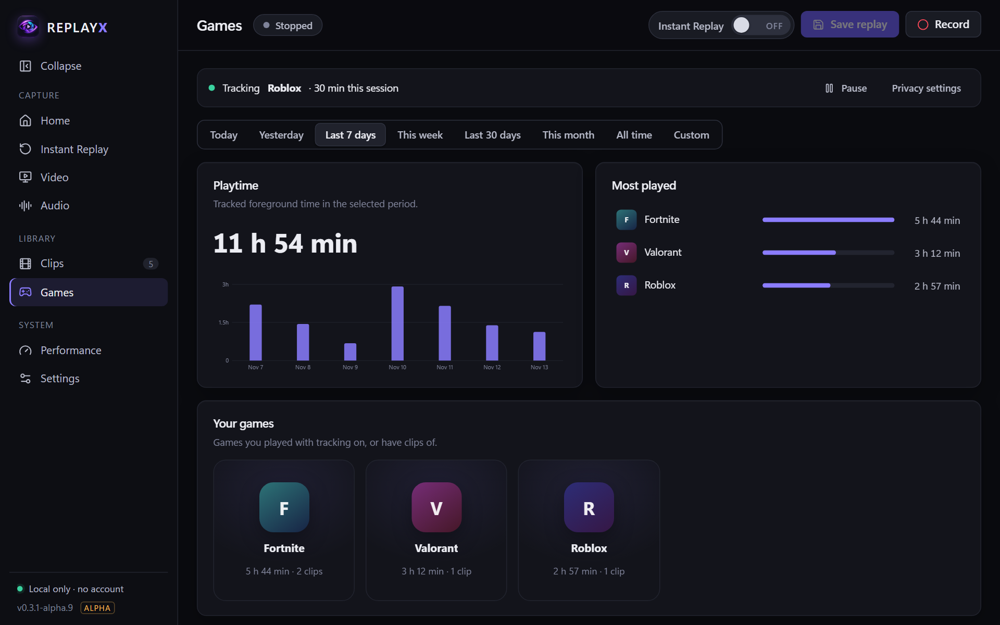
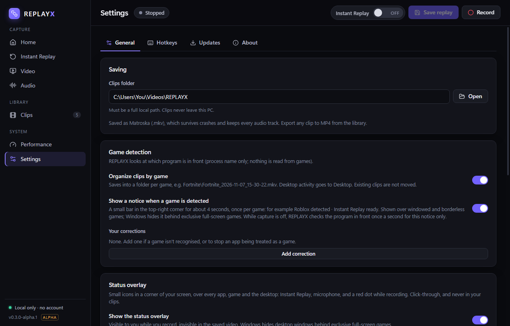

# Features

  
  

## Instant Replay
Turn it on before you play. REPLAYX keeps a rolling window of the last 30 seconds to 30 minutes **on disk** (not in memory), bounded by a disk budget you choose. Press <kbd>Ctrl</kbd>+<kbd>Shift</kbd>+<kbd>F10</kbd> and the last moments are saved as a clip; buffering carries on, and overlapping saves are fine. Clips are joined from finished 2-second segments without re-encoding, so a 60-second replay is usually ready about a second after you press save. Presets (*Short clips*, *Balanced*, *Long sessions*) show how much disk each needs.

## Recording
<kbd>Ctrl</kbd>+<kbd>Shift</kbd>+<kbd>F9</kbd> starts and stops a normal recording. If Instant Replay is running, the recording joins it instantly, without restarting capture or leaving a gap. Files are Matroska (`.mkv`), which survives crashes, and an interrupted session can be recovered from the Instant Replay page.

## Quality and hardware encoding
- **Exact output size:** 720p, 1080p, 1440p, 4K, your display's shape or custom. 1920 × 1080 always saves a 1920 × 1080 file; stretched 4:3 gameplay can be recorded full-frame.
- **Presets:** Performance, Balanced, High quality or a custom bitrate, with a *Recommended* tag for your hardware. On NVIDIA GPUs the presets use constant quality with a size cap (measured: the same picture for about 12% less space).
- **Codecs:** H.264 (default, plays everywhere), HEVC and AV1 (about 25% smaller than H.264 at the same measured quality). Only codecs your PC can encode are offered, and REPLAYX never switches codec by itself.
- **Encoders:** NVIDIA NVENC, Intel Quick Sync and AMD AMF, chosen by real probes, with a CPU fallback. A storage estimate shows MB per minute, GB per hour and the recording time left on your drive.

## Microphone and Voice Enhancer

  

Your microphone is recorded on **its own track**, cleaned up by REPLAYX's own real-time processing:

| Preset | What it does |
| --- | --- |
| **Off** | Your microphone exactly as Windows delivers it. |
| **Natural** | Removes rumble and a little background noise; sounds like your mic, only cleaner. |
| **Clear** (recommended) | Removes background noise, makes words easier to understand, evens out levels gently. |
| **Broadcast** | A fuller, steadier "streamer" voice: warmth, presence, stronger compression, softer S sounds. |
| **Noise-Free** | The strongest background-noise removal, quiet between words. |

Noise suppression (Off, Light, Balanced, Strong) uses **RNNoise**; in our tests on speech mixed with fan noise it removed about 10, 17 and 25 dB of the noise while leaving the speech practically unchanged, using about 1% of one CPU core. **Test mic** plays you back live, switching between *Enhanced* and *Original* at the same loudness; **Compare** records one short take (kept in memory only) to hear both versions of the same words. Fine-tune gives you gain, a rumble filter, a soft gate, compressor, EQ and de-esser, and you can save your own presets. REPLAYX never changes your Windows microphone level.

## Separate audio tracks
The home page has a **microphone switch**: turn your microphone off and on in recordings with one click, also in the middle of a recording (the mute shortcut and the tray do the same). System sound, individual apps (game, Discord, music) and your microphone each get their own track, plus a full mix on track 1 so every player plays everything. New microphones and headsets are picked up automatically.

## Clips library and game detection

  
  

REPLAYX recognises 140 games (Fortnite, Roblox, Valorant, Minecraft, Counter-Strike 2, Apex Legends, Call of Duty, Overwatch 2, League of Legends, Genshin Impact and more, plus games in Steam, Epic, Xbox and other store folders) by the name of the program in front. It never injects into or reads from games. Clips are saved as `Videos\REPLAYX\<Game>\<Game>_2026-11-07_21-30-12.mkv`.

Browse **All clips** or **By game**; sort by date, game, length, size or type; filter by game, type and dates; search; rename, change the game, export to MP4 or delete to the Recycle Bin. Each game shows its own icon, taken from the game installed on your PC or from its executable once you've played it. Nothing is downloaded.

## Games and playtime

  

The **Games** page shows how long you played each game today, yesterday, this week, this month, over the last 7 or 30 days, all time or any dates you choose, with a daily chart, your most-played games and a page per game. It counts only time while the game is the window in front and REPLAYX is running, skips idle stretches (15 minutes without keyboard or mouse, adjustable) and sleep, and stays on your PC. Pause it, exclude games, export it to CSV, clear it or turn it off in **Settings**.

## Status overlay and pop-ups

  

Small icons in a corner of your screen show Instant Replay, your microphone and a red dot while recording (with an optional timer), over games, apps and the desktop. Windows keeps them **out of your recordings** (verified on captured frames). A short pop-up slides in for *Recording started*, *Instant Replay saved*, *Recording saved* or *Save failed*. Silent, click-through, never steals focus, never in your clips; both can be turned off.

## Updates
REPLAYX tells you when a new version is out: a dot on **Settings**, and a pop-up with what's new and an **Update Now** button. It downloads with visible progress, checks the publisher's signature, installs and restarts; your clips, settings and playtime stay. It never interrupts a recording or a save. Choose **Manual**, **Notify me** (default) or **Auto update** in **Settings → Updates**.

## Light on your games
While hidden in the tray, REPLAYX draws nothing and checks its status only every 2 seconds. The once-a-second game check costs about 17 µs (≈0.002% of one CPU core), and work after capture (joining clips, checks, thumbnails) runs below normal priority. Controlled synthetic proxy runs measured 2.9–3.3% overhead at 1080p60. Real-game overhead remains unresolved; see [Performance](../development/PERFORMANCE.md).

## Private by design
No account, telemetry, analytics or uploads. Recordings, settings, playtime and microphone tests stay on your PC. See [Privacy](PRIVACY.md).
